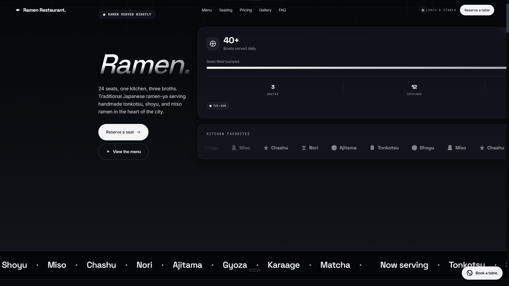
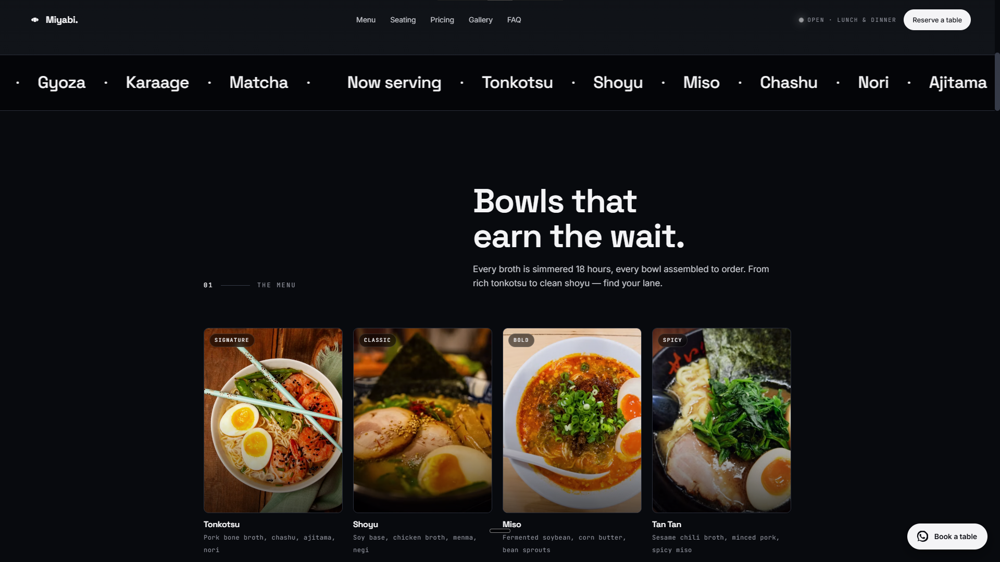
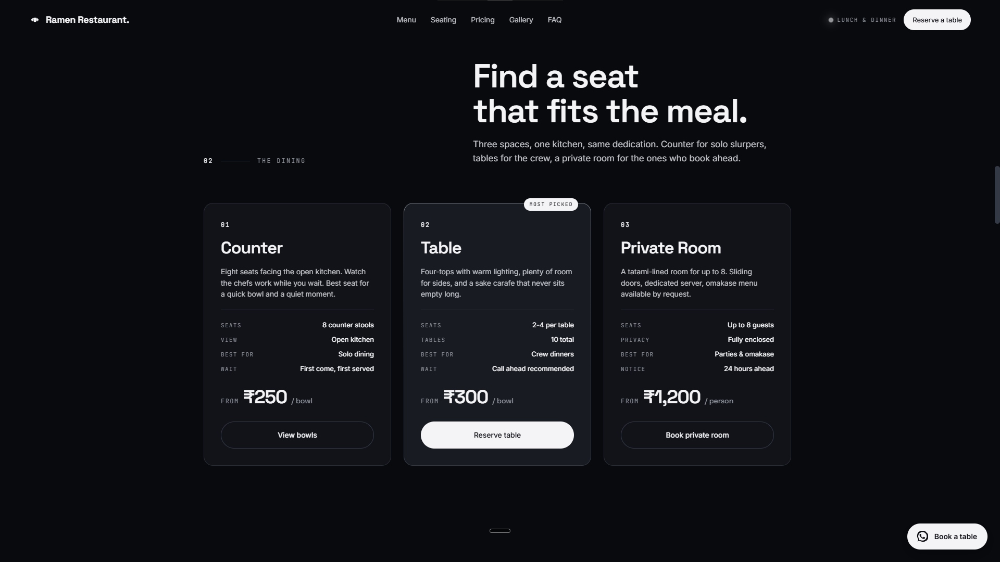
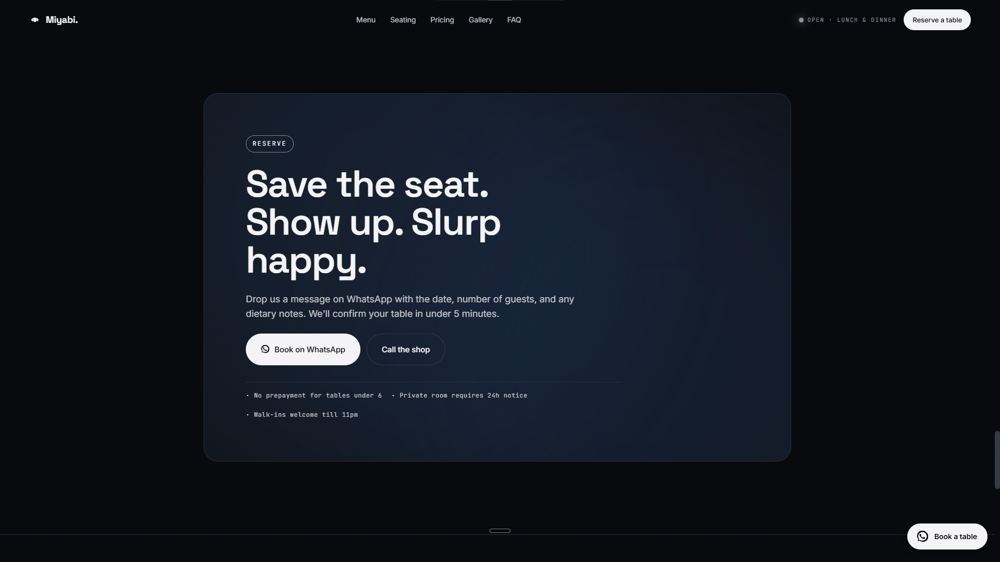

# Ramen Restaurant — Japanese Ramen & Kitchen

A landing page concept for an intimate Japanese ramen-ya in Connaught Place, New Delhi.

> **Demo concept.** Ramen Restaurant is a fictional restaurant created only to showcase web design and development work. The name, menu, prices, reviews, phone number, email, address and social links are illustrative and do not belong to any real business. Photography is sourced from Unsplash. Built by CodeX.

🔗 **Live:** https://japanese-ramen.akshaycodecrafter.workers.dev/

## Preview






## About

Ramen Restaurant started as a question I kept running into with ramen-shop websites: why do they either look like generic restaurant templates or overdo the "kawaii" aesthetic? I wanted something that felt closer to an actual late-night ramen counter — dim, warm, a little intimate — built around the idea of one kitchen and three broths done properly rather than a sprawling menu. The layout leans on dark tones, a subtle noise texture, and scroll-reveal animations to keep the focus on the food.

## What's on the page

- **Hero** — the "24 seats, one kitchen, three broths" statement with live-feeling stats
- **Kitchen Favorites** — a marquee of signature ingredients (Tonkotsu, Shoyu, Miso, Chashu, Nori, Ajitama)
- **Menu** — nine ramen and side dishes with photography and pricing
- **Seating** — counter, table, and private room layout
- **Pricing** — per-bowl and set pricing toggle
- **Gallery** — six shots of the space and dishes
- **FAQ** — accordion-style common questions
- **Book a table** — WhatsApp and phone-based reservation flow (no backend form, direct-contact links only)

## Built with


- Vanilla HTML/CSS/JS — no frameworks, no build step
- IntersectionObserver-based scroll reveals, smooth-scroll navigation, and a pricing toggle
- Fully responsive, accessible reduced-motion support

## Why I built it this way

I stuck with plain HTML/CSS/JS instead of a framework for the same reason as my other landing-page concepts: a single page like this doesn't need a build pipeline, and keeping it framework-free means anyone can open it and understand the whole thing in a few minutes. The trade-off is a longer single-purpose CSS file rather than reusable components, but for a project this size that's the right call.

## Running it locally

```
Ramen-Restaurant/
├── index.html
├── css/
│ └── style.css
├── js/
│ └── script.js
└── assets/
```

Just clone the repo and open `index.html` in a browser — no build step, no dependencies.

## Status

Demo/concept build. Contact details, pricing, and reservation flow are illustrative only.
